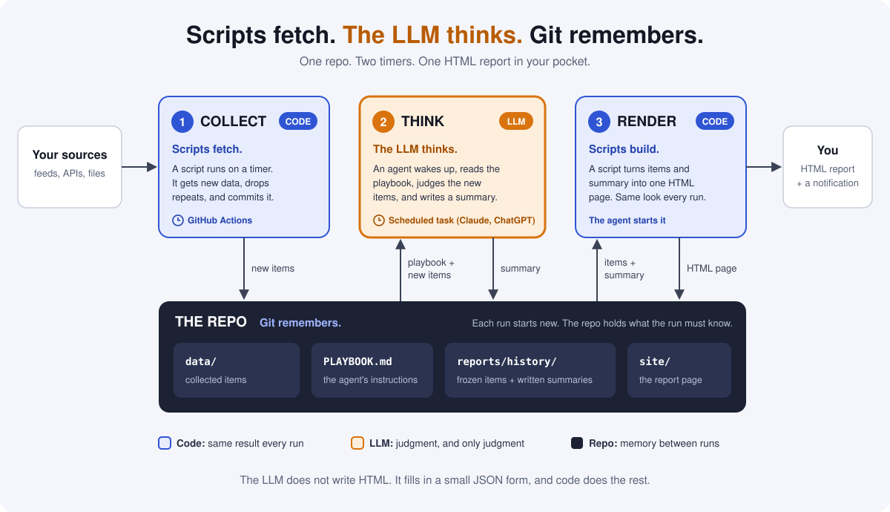

# ai-agent-template

**Scripts fetch. The LLM thinks. Git remembers.**

This is a template for a report that writes itself. On a schedule, an AI agent wakes up,
reads the new data in this repo, decides what matters, and sends you an HTML report.
You drink your coffee.

<p align="center">
  
</p>

## The idea

An LLM is good at judgment. It is a bad cron job, a bad database and a moody web designer.
So each part of the system gets one job:

| Part | Job | Who does it |
|---|---|---|
| **Collect** | Get new data. Remove repeats. Commit the result. | A script, on a CI schedule |
| **Think** | Read the new items. Decide what matters. Write a short summary. | An LLM agent, in a scheduled task |
| **Render** | Put the items and the summary into one HTML page. | A script |
| **Remember** | Keep the instructions, the data and each past report. | This repo |

The LLM does not write HTML. It fills in a small JSON file, and code does the rest.
As a result, each report has the same layout, each item comes from real data, and you can
test everything but the opinions.

## Try it in one second

```bash
python demo.py
```

No network. No API key. No agent. The demo runs the three steps in a scratch folder with
sample data, and canned text stands in for the LLM. Open `.demo/site/index.html` to see
the result.

You need Python 3.11 or later. There is nothing to install.

## Make it yours

1. Click **Use this template** to make your own repo. If your data is personal, make the repo private.
2. Edit `config.json`. Give the report a name, write the one `question` that each report
   must answer, describe the `reader`, and add your `sources`.
3. Add your own rules to the **House rules** section of `PLAYBOOK.md`.
4. Do a test: `python collect.py`, then `python build_report.py pending`.
5. Put the agent on a schedule.

## Put the agent on a schedule

The agent must be able to do three things: start on a schedule, run Python, and push to
your repo. Then it needs only this prompt:

```text
You are the report agent for the GitHub repo <OWNER>/<REPO>.

1. Get the newest version of the repo.
2. Open PLAYBOOK.md. Do each step, in order. Do not skip a step.
3. Write only from the data in the repo. Do not invent facts.
4. Commit your work and push it to the main branch. Do not open a pull request.
5. When you are done, send me the notification text and the link to the report.
```

The prompt is short on purpose. The real instructions are in `PLAYBOOK.md`, so you change
the agent's behavior with a commit, not with a new prompt.

- **Claude:** make a [scheduled task](https://code.claude.com/docs/en/routines), select your
  repo, paste the prompt and pick a time.
- **ChatGPT:** make a [scheduled task](https://learn.chatgpt.com/docs/automations) from a
  Codex chat in your clone of the repo, and paste the same prompt. Let the task use the
  network, because it must push. A task on a local project runs only while the desktop app
  is open and the computer is on.

Product menus change faster than READMEs. If a step does not agree with your screen, the
linked page is correct.

## One run, step by step

1. **Collect.** `collect.yml` runs `collect.py` on a timer. New items go to `data/items/`.
   Each item that the collector sees goes to `data/seen.json`, so no item is reported twice.
2. **Freeze.** The agent runs `build_report.py pending`. This saves the exact set of new
   items to `reports/history/<date>.items.json` and prints the set.
3. **Think.** The agent reads the items and writes `reports/history/<date>.summary.json`:
   a headline, a notification, an overview, optional sections, and one note for each item.
   For an item that is off-topic, the note is the word `skip`.
4. **Render.** The agent runs `build_report.py render`. This builds `reports/<date>.html`
   and `site/index.html`, and prints a warning for each problem in the summary.
5. **Deliver.** The agent commits, publishes the page and sends you the notification.

## What is in the box

| Path | What it is |
|---|---|
| `PLAYBOOK.md` | The steps that the agent does on each run |
| `config.json` | The question, the reader and the sources |
| `collect.py` | Step 1: get new items. No LLM |
| `build_report.py` | `pending` freezes the new items, `render` builds the HTML, `status` shows which sources failed |
| `report/sources.py` | The source types: `rss`, `json` and `sample` |
| `report/store.py` | The file layout and the list of seen items |
| `report/render.py`, `report/template.html` | The HTML report. Change the look here |
| `demo.py` | The full loop with sample data |
| `tests/` | Offline tests: `python -m unittest discover tests` |
| `.github/workflows/` | `collect.yml` is the timer for step 1. `tests.yml` runs the tests |

The folders `data/`, `reports/` and `site/` appear after the first run.

## Sources

A source is one entry in `config.json`:

```json
{"id": "my-feed", "name": "My feed", "group": "Group one", "type": "rss", "url": "https://example.com/feed.xml", "keywords": []}
```

- `rss` reads an RSS or Atom feed.
- `json` reads a JSON API (`url`) or a JSON file in the repo (`path`). Use `items_path` and
  `fields` to say where the data is.
- For a different type of source, add a function with `@driver("name")` to `report/sources.py`.

`keywords` is a loose first filter. An empty list keeps everything. The agent makes the
final decision, because that is its job.

## Keep it safe

- Put each API key in your CI secrets. In `config.json`, write `${MY_KEY}`, and the collector
  reads the value from the environment. Do not commit a key.
- Your copy of this repo holds your data and your reports. If they are private, make the repo private.
- The agent can push to your repo. Give it access to this repo only.

## License

[Apache 2.0](LICENSE)
